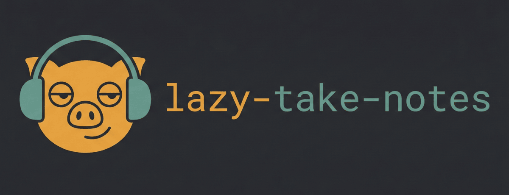
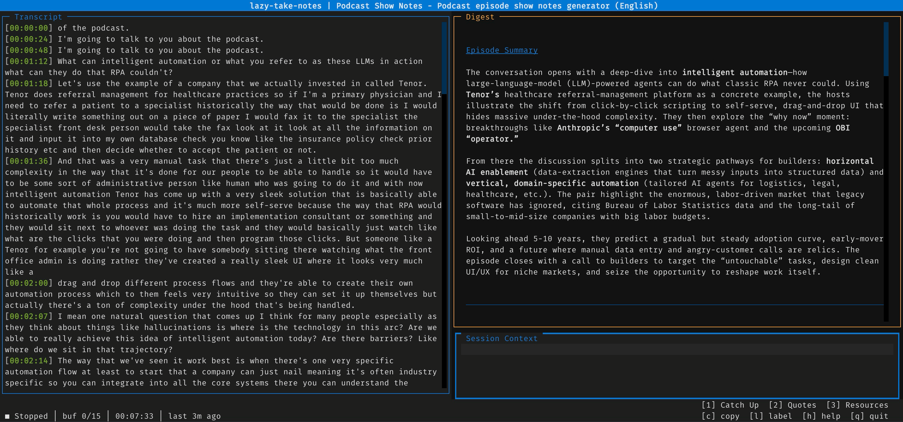

<p align="center">
  
</p>

A terminal app that takes your meeting notes. It records your mic and your system audio, transcribes the speech on your machine, and keeps a summary up to date while you talk.



## Install

On macOS or Linux, run this in a terminal:

```bash
curl -fsSL https://raw.githubusercontent.com/CJHwong/lazy-take-notes/main/setup.sh | bash
```

The script installs [uv](https://docs.astral.sh/uv/), helps you pick an AI provider ([Ollama](https://ollama.com) or any OpenAI-compatible API), and adds a `take-note` command. It asks before it runs.

If you already have uv, you can skip the script. This runs the app straight from GitHub. uv still downloads it to its cache, but you get no `take-note` command and no config file:

```bash
uvx --from git+https://github.com/CJHwong/lazy-take-notes.git lazy-take-notes
```

On a Mac with Apple silicon, the app is a native build. Other systems run the Python version. See [Rust and Python versions](docs/explain_rust_and_python.md).

## First run

1. Run `take-note record`.
2. Pick a template, for example `default_en`.
3. Talk. The transcript fills the left panel, and the notes update on the right. Press `s` to stop, then `q` for the final notes.

Your sessions are saved in `~/Documents/LazyTakeNotes`. The [getting started tutorial](docs/tutorial_getting_started.md) walks through the setup step by step.

## Documentation

**Learn**

- [Getting started](docs/tutorial_getting_started.md)

**Do a task**

- [Label speakers](docs/howto_speaker_labels.md)
- [Create and edit templates](docs/howto_templates.md)
- [Write a plugin](docs/howto_plugins.md)
- [Build the desktop app](docs/howto_desktop_app.md)
- [Develop and release](docs/howto_develop_and_release.md)

**Look something up**

- [Commands](docs/ref_commands.md)
- [Keys](docs/ref_keys.md)
- [Configuration](docs/ref_configuration.md)
- [Settings screen](docs/ref_settings.md)
- [Session files](docs/ref_output_files.md)
- [Template schema](docs/ref_template_schema.md)
- [Plugin API](docs/ref_plugin_api.md)

**Understand**

- [Rust and Python versions](docs/explain_rust_and_python.md)
- [How speaker labels work](docs/explain_speaker_labels.md)
- [The model cache](docs/explain_model_cache.md)

## Credits

Speech recognition uses these open models. Thanks to their authors:

- **[whisper.cpp](https://github.com/ggerganov/whisper.cpp)** by Georgi Gerganov: the inference runtime, plus OpenAI's [Whisper](https://github.com/openai/whisper) `large-v3-turbo` (MIT), the default model.
- **[Breeze-ASR-25](https://huggingface.co/MediaTek-Research/Breeze-ASR-25)** by MediaTek Research (Apache-2.0): fine-tuned from `whisper-large-v2` for Mandarin and Traditional Chinese. whisper.cpp build by [alan314159](https://huggingface.co/alan314159/Breeze-ASR-25-whispercpp).
- **[Breeze-ASR-26](https://huggingface.co/MediaTek-Research/Breeze-ASR-26)** by MediaTek Research (Apache-2.0): Taiwanese Hokkien (台語). GGML build by [phate334](https://huggingface.co/phate334/Breeze-ASR-26-GGML).
- **[NeMo-Speech.cpp](https://github.com/NVIDIA/NeMo-Speech.cpp)** and Nemotron 3 Diarization by NVIDIA: speaker labels.

Notes and quick actions run on a local model through [Ollama](https://ollama.com) (default `gpt-oss:20b`), or on any OpenAI-compatible API.

## License

MIT
