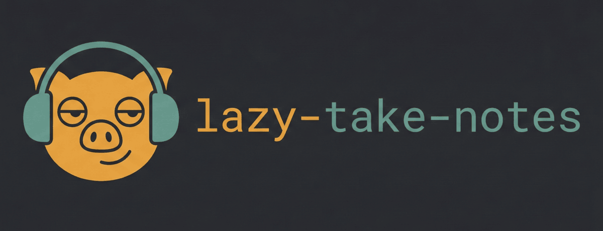
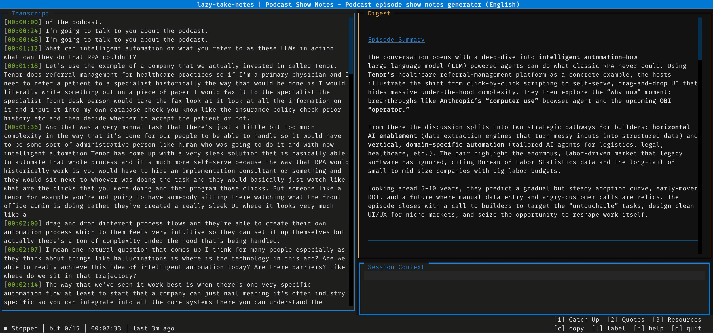

<p align="center">
  
</p>

Terminal app for live transcription and note-taking. Records your mic, transcribes speech to text, and periodically generates structured digests of what's happening.



## Requirements

- Python 3.11+
- A microphone
- A transcription engine ([whisper.cpp](https://github.com/ggerganov/whisper.cpp) by default)
- An LLM backend ([Ollama](https://ollama.com) by default, or any [OpenAI-compatible API](https://platform.openai.com/))

## Install

### Quick setup

Run this in Terminal — it installs everything and sets up a `take-note` shortcut:

```bash
curl -fsSL https://raw.githubusercontent.com/CJHwong/lazy-take-notes/main/setup.sh | bash
```

The script first warns that a piped script runs as you and asks `[Y/n]`. An agent or CI job has no terminal, so it passes `-y`: `curl ... | bash -s -- -y`.

Then run `take-note record`.

### Manual install

```bash
# try without installing (uv required)
uvx --from git+https://github.com/CJHwong/lazy-take-notes.git lazy-take-notes

# or clone and install locally
uv sync

# or pip
pip install -e .
```

**New to this?** See the [Getting Started guide](docs/GETTING_STARTED.md) for step-by-step setup instructions.

## Run

```bash
take-note                                     # interactive mode selector
take-note record                              # start recording
take-note record -l sprint-review             # record with session label
take-note transcribe recording.m4a            # transcribe an audio file
take-note view                                # browse saved sessions
take-note config                              # open the settings editor
take-note create-template                     # build a custom template with AI
take-note --config path/to/config.yaml        # custom config
take-note --output-dir ./my_session           # custom output dir
```

> `lazy-take-notes` works as an alias for `take-note`.

## Keys

| Key     | Action                          |
| ------- | ------------------------------- |
| `Space` | Pause / resume recording        |
| `s`     | Stop recording                  |
| `c`     | Copy focused panel to clipboard |
| `Tab`   | Switch panel focus              |
| `h`     | Help                            |
| `q`     | Quit                            |

Templates can add more keys for quick actions (catch up, action items, etc). Press `h` in the app to see all available bindings.

## Config

Config lives in your OS config directory:

| OS      | Path                                             |
| ------- | ------------------------------------------------ |
| macOS   | `~/Library/Application Support/lazy-take-notes/` |
| Linux   | `~/.config/lazy-take-notes/`                     |
| Windows | `C:\Users\<you>\AppData\Local\lazy-take-notes\`  |

`take-note config` warns before it closes with unsaved changes.

Example `config.yaml`:

```yaml
# LLM provider: 'ollama' (default) or 'openai' (any OpenAI-compatible API)
llm_provider: ollama

ollama:
  host: "http://localhost:11434"

# OpenAI-compatible provider (OpenAI, Gemini, Groq, Together, vLLM, etc.)
# openai:
#   api_key: sk-...               # or set OPENAI_API_KEY env var
#   base_url: "https://api.openai.com/v1"

recognition_hints:                  # global hints for the speech recogniser
  - "Kubernetes"                    # applied to every template (merged with per-template hints)
  - "JIRA"

transcription:
  model: "large-v3-turbo-q8_0"    # default whisper model
  models:                         # per-locale overrides
    zh: "breeze25-q8"             # Breeze-ASR-25, Mandarin / Traditional Chinese
    zh-min-nan: "breeze26"        # Breeze-ASR-26, Taiwanese Hokkien (台語)
  chunk_duration: 25.0
  overlap: 1.0
  silence_threshold: 0.01
  pause_duration: 1.5
digest:
  model: "gpt-oss:20b"            # heavy model for periodic digests
  min_lines: 15
  min_interval: 60
  compact_token_threshold: 100000
interactive:
  model: "gpt-oss:20b"            # fast model for quick actions
output:
  directory: "./output"
  save_audio: true                # save recording.wav alongside transcript
  save_notes_history: true        # keep numbered snapshots in history/
  save_context: true              # save session context text
  save_debug_log: false           # write debug.log (off by default)
```

## Templates

Templates control the LLM prompts, labels, and quick-action keys for a session. The template picker launches at startup — built-ins are listed there.

To add your own or override a built-in, drop a `.yaml` file in the `templates/` subdirectory of your config path (see table above). See [docs/TEMPLATES.md](docs/TEMPLATES.md) for the full schema and variable reference.

## Output

After a session:

```
output/
├── transcript.txt            # timestamped transcript
├── notes.md                  # latest notes/digest (markdown)
├── context.txt               # user-provided context (when save_context: true)
├── recording.wav             # audio recording (when save_audio: true)
├── debug.log                 # debug log (when save_debug_log: true)
└── history/                  # numbered snapshots (when save_notes_history: true)
    ├── notes_001.md
    ├── notes_002.md
    └── notes_003_final.md    # final digest on quit/stop
```

## Speaker labels (experimental)

Speaker labels need the native NeMo-Speech.cpp runtime and the Nemotron-3-Diarization GGUF. Install both from Settings:

```bash
take-note config
```

Open the **Models** tab and press `Download` next to `NeMo Speech runtime` and `Nemotron 3 diarization`. The app downloads about 116 MB once, checks the pinned SHA-256 digest, and stores both in the shared cache. No paths to type.

The app reads the recording while it runs, so `save_audio` must be on. `take-note diarize <session-dir>` labels a saved transcript with the same installed runtime and model.

For a custom build, set an absolute path in `config.yaml`, or export the old overrides:

```bash
export LTN_NEMO_BINARY=/path/to/nemo-speech
export LTN_NEMO_MODEL=/path/to/Nemotron-3-Diarization.q8_0.gguf
take-note diarize output/2026-11-08_100000_standup
```

The command writes `speakers.json` and `transcript_speakers.txt` in the session directory.

Labels are local to one session. `S1` in one meeting is not the same person as `S1` in another. Diarization runs offline: 20 minutes of audio took 3.7 s on Metal, and 61 minutes took 44 s on CPU.

### Live speaker labels

Enable **Speaker Labels** on the **Audio** page. Install the runtime and model from the **Models** page. The app reuses the installed files and runs one pass over the audio recorded so far every 60 seconds. The same controls are in `config.yaml`:

```yaml
diarization:
  enabled: true
  device: auto        # auto, cpu, or metal
  interval_s: 60      # one full pass over the audio so far
output:
  save_audio: true    # diarization reads the recording
```

`binary` and `model` are optional overrides. Leave them blank to use the managed cache.

A bar under the transcript shows the speakers found so far, with their speech time. Click a chip to name that speaker. The name replaces `S1` in the transcript, is saved to `speakers.json`, and is used in the digest prompt, so the notes can attribute statements to a person.

Speaker numbers follow arrival order, so a label already on screen stays valid when a new voice joins. Each pass reads the whole recording, which is cheap: about 11 s per hour on Metal.

## Settings

`take-note config` opens the settings screen. The app also opens it from the mode picker.

| Page | What it controls |
| --- | --- |
| Models | Text generation provider and models, speech models, language overrides, speaker runtime install |
| Digest | Summary triggers and token compaction |
| Audio | Live input test, microphone choice, audio processing, speaker labels |
| Sessions | Output folder, save toggles, auto-label, vocabulary, built-in templates |
| Appearance | Theme and the recording preview |

Pages use the full window: a left navigation column, then two content columns. Models is first because it is the setup page. Below about 100 columns, the two content columns stack.

The Models page lists each transcript model as a row with its size, state, and one action. Language overrides use `Add language` rows with a locale and a model picker. Speaker runtime and model show only a status and an install or remove action. No model paths are exposed. Advanced settings are always visible. No page uses collapsible sections.

Model assets live in one cache. The path is `platformdirs.user_cache_path('lazy-take-notes')`, which is `~/Library/Caches/lazy-take-notes` on macOS. The Models tab shows each asset, its size, and its state. Downloads resume, show progress, and can be cancelled. The app verifies a pinned SHA-256 for every file and never executes an unverified runtime.

On first use the app adopts models from the old `pywhispercpp` cache and the old `~/.cache/nemotron-diarization` store. It links or copies them and leaves the originals in place.


## Desktop app (macOS)

Build a `.app` that runs the TUI in its own window using [Trolley](https://github.com/weedonandscott/trolley) and [libghostty](https://github.com/ghostty-org/ghostty):

```bash
brew install weedonandscott/tap/trolley
scripts/trolley/build.sh --run     # build, add the mic usage string, and launch
scripts/trolley/build.sh           # build .app only
```

The build script inserts `NSMicrophoneUsageDescription` into the app's `Info.plist` after Trolley packages it. Trolley has no config key for that entry, and macOS denies microphone access to the app without it.

The bundle ships a launcher script, not a frozen Python binary. On first launch it installs the app into a uv tool environment, then reuses that environment on every later launch. The target machine needs `uv`, plus the CLI prerequisites: `ffmpeg`, and either Ollama or an OpenAI-compatible endpoint. If `uv` is missing, the launcher prints the install command and exits.

The bundle sets three environment variables in `trolley.toml`:

| Variable | Value | Why |
| --- | --- | --- |
| `LTN_OUTPUT_DIR` | `~/Documents/LazyTakeNotes` | The default `./output` would land inside the bundle. |
| `LTN_KIOSK` | `1` | Returns to the mode picker after a session instead of exiting. |
| `TEXTUAL_DRIVER` | `...drivers.ghostty_driver:GhosttyDriver` | Turns off the Kitty keyboard protocol under Trolley. Leaving it on breaks arrow keys. |

Moving the window between displays with different scale factors can leave the terminal grid at the wrong size. Drag a window edge to re-sync it. The cause and the upstream patch are in [docs/TROLLEY_DISPLAY_SCALE.md](docs/TROLLEY_DISPLAY_SCALE.md).

The launcher installs from `main` by default. A bundle built from an unmerged branch must point at that checkout, or the installed code will not match the driver the bundle expects:

```bash
LTN_DESKTOP_SOURCE=/path/to/lazy-take-notes scripts/trolley/build.sh --run
```

The produced `.app` is ad-hoc signed. Distributing it to another machine needs a Developer ID signature and notarization. `scripts/release.sh` does both when they are available, and the last line of its output says whether it did:

```bash
scripts/release.sh                          # build, sign if possible, zip
scripts/release.sh --dmg                    # also produce a DMG
LTN_NOTARY_PROFILE=ltn scripts/release.sh   # also notarize
```

Artifacts land in `trolley/release/`. Signing runs when the keychain holds a `Developer ID Application` identity, or when `LTN_SIGN_IDENTITY` names one. Notarization runs when `LTN_NOTARY_PROFILE` names a `notarytool` keychain profile. Without them the script still builds and packages, and reports `UNSIGNED`.

## Development

```bash
uv sync                  # install deps
uv run pytest tests/ -v  # run tests
uv run lint-imports      # check layer contracts
```

Architecture details are in [AGENTS.md](AGENTS.md). To build your own source plugin, see the [Plugin Development Guide](docs/PLUGINS.md).

## Credits

Speech recognition is powered by these open models. Thanks to their authors:

- **[whisper.cpp](https://github.com/ggerganov/whisper.cpp)** by Georgi Gerganov: the inference runtime, plus OpenAI's [Whisper](https://github.com/openai/whisper) `large-v3-turbo` (MIT) used by default.
- **[Breeze-ASR-25](https://huggingface.co/MediaTek-Research/Breeze-ASR-25)** by MediaTek Research (Apache-2.0): fine-tuned from `whisper-large-v2` for Mandarin / Traditional Chinese. whisper.cpp build by [alan314159](https://huggingface.co/alan314159/Breeze-ASR-25-whispercpp).
- **[Breeze-ASR-26](https://huggingface.co/MediaTek-Research/Breeze-ASR-26)** by MediaTek Research (Apache-2.0): Taiwanese Hokkien (台語), GGML build by [phate334](https://huggingface.co/phate334/Breeze-ASR-26-GGML).

Digests and quick actions run on a local LLM via [Ollama](https://ollama.com) (default `gpt-oss:20b`) or any OpenAI-compatible API.

## License

MIT
